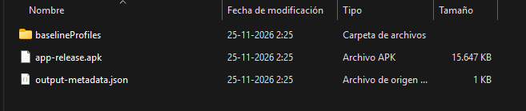
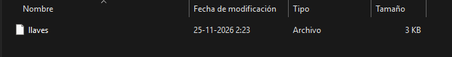

# Espacio360

**Sistema móvil de gestión y reserva de salas**

Aplicación Android para solicitar, validar y administrar el uso de salas y recintos de una sede, con flujos diferenciados para relatores y coordinadores.

## Contenido

1. [Nombre del proyecto](#1-nombre-del-proyecto)
2. [Integrantes](#2-integrantes)
3. [Funcionalidades](#3-funcionalidades)
4. [Endpoints utilizados](#4-endpoints-utilizados)
5. [Pasos para ejecutar](#5-pasos-para-ejecutar)
6. [Captura del APK firmado y archivo .jks](#6-captura-del-apk-firmado-y-archivo-jks)

---

## 1. Nombre del proyecto

**Espacio360** es una aplicación móvil nativa para Android orientada a la gestión de infraestructura. Permite a los relatores buscar salas, consultar su disponibilidad y solicitar reservas para sus actividades, y a los coordinadores validar esas solicitudes, administrar los recintos y sus horarios, y revisar reportes de ocupación y el historial de acciones de la sede.

| Característica | Detalle |
|---|---|
| Nombre comercial | Espacio360 |
| Nombre del módulo | Gestión de Reservas |
| Identificador de la aplicación | `com.example.gestiondereservas` |
| Versión | 1.0 (código de versión 1) |
| Plataforma | Android, versión mínima 8.0 (API 26) |
| Lenguaje | Kotlin |

### Tecnologías

| Componente | Tecnología |
|---|---|
| Interfaz de usuario | Jetpack Compose con Material 3 |
| Arquitectura | MVVM (vistas, ViewModels y repositorios) |
| Navegación | Navigation Compose |
| Consumo de servicios | Retrofit 2.11.0, OkHttp 4.12.0 y Gson |
| Persistencia local | Room 2.8.4 |
| Tareas en segundo plano | WorkManager 2.10.5 |
| Animaciones | Lottie Compose 6.6.7 |
| Gestión de fechas y horas | `java.time` con desugaring para versiones antiguas de Android |
| Compilación | Gradle 9.6.0, Android Gradle Plugin 9.3.1 y Kotlin 2.2.10 |

### Organización del código

El código fuente se encuentra en `app/src/main/java/com/example/gestiondereservas` y está organizado por responsabilidad:

| Paquete | Contenido |
|---|---|
| `ui/views` | Pantallas de la aplicación |
| `ui/components` | Componentes reutilizables y estructura base por rol |
| `ui/theme` | Colores, tipografía y tema |
| `viewmodel` | Estado y lógica de cada pantalla |
| `data/repository` | Repositorios que centralizan el acceso a los datos |
| `data/remote` | Cliente Retrofit, servicios de red, DTO y gestión de la sesión |
| `data/room` | Base de datos local, DAO y entidades |
| `navigation` | Grafo de navegación |
| `workers` y `utils` | Tareas programadas, notificaciones, validaciones y utilidades |

---

## 2. Integrantes

| Nombre |
|---|
| Alejandro Rivera |
| Leonel Barrientos |
| Geraldinne Gonzalez |
| Gonzalo Hormazabal |

---

## 3. Funcionalidades

La aplicación define dos perfiles de usuario: **Relator / Trabajador**, que solicita y utiliza las salas, y **Coordinador**, que valida las solicitudes y administra la infraestructura.

### 3.1 Registro e inicio de sesión

- Registro de cuenta con nombre completo, correo, teléfono, contraseña y confirmación de contraseña, eligiendo el perfil operativo (Relator / Trabajador o Coordinador).
- Inicio de sesión con correo, contraseña y perfil seleccionado. El sistema dirige al panel correspondiente según el rol.
- Validaciones en pantalla:
  - El correo debe ser institucional (`@duocuc.cl` o `@therionlabs.cl`).
  - La contraseña debe tener al menos 6 caracteres, e incluir una mayúscula, una minúscula y un número.
  - El teléfono debe tener un formato válido y las contraseñas deben coincidir al registrarse.
- Autenticación mediante token JWT, que se envía en el encabezado `Authorization` en las consultas protegidas. Al cerrar sesión se elimina la información de la sesión.

### 3.2 Funcionalidades del Relator / Trabajador

| Funcionalidad | Descripción |
|---|---|
| Panel de inicio | Muestra la información de la próxima reserva con su estado (pendiente, aprobada o rechazada), la opción de activar un recordatorio y accesos directos a las funciones principales |
| Búsqueda de salas | Búsqueda por código o nombre, con filtros por fecha, hora, capacidad máxima, área de conocimiento y equipamiento disponible |
| Calendario de disponibilidad | Vista semanal por sala con leyenda de bloques reservados, clases, montaje y horarios bloqueados, para elegir un bloque disponible |
| Solicitud de reserva | Formulario guiado en tres pasos, descrito más abajo |
| Mis reservas | Listado de las reservas realizadas con su estado |
| Uso de sala | Inicio y seguimiento de la actividad aprobada, con tiempo restante y progreso, y finalización de la actividad |
| Reporte de inconvenientes | Registro de problemas ocurridos durante el uso de la sala |
| Evaluación de la sala | Calificación y observaciones una vez finalizada la actividad |
| Notificaciones | Avisos sobre la aprobación, el rechazo o la revisión pendiente de las solicitudes, con la opción de marcarlas como leídas |

**Formulario de solicitud de reserva**

1. **Actividad:** nombre, descripción, tipo de actividad y área o escuela que organiza.
2. **Requisitos:** recinto, fecha y horario, montaje (fecha y hora), público invitado, nombres del público externo cuando corresponde y adjunto del programa, pauta o libreto en formato PDF (máximo 5 MB).
3. **Servicios:** requerimientos de Comunicaciones (registro de fotos y videos, difusión en redes sociales), Extensión, Servicios Generales (aseo, montaje y mobiliario), Servicios Digitales y CTA (amplificación, micrófonos, iluminación, proyección y streaming), además de un campo para complementos.

Al enviar la solicitud, esta queda pendiente de validación por el coordinador.

### 3.3 Funcionalidades del Coordinador

| Funcionalidad | Descripción |
|---|---|
| Panel de inicio | Reservas por confirmar con aprobación o rechazo directo y accesos a Horarios, Auditoría, Reportes y Salas |
| Gestión de reservas | Listado de solicitudes pendientes, aprobadas y rechazadas, con detalle completo y documento adjunto; permite aprobar o rechazar |
| Gestión de salas | Creación y modificación de recintos (código, nombre, capacidad, área, equipamiento y fotografía), búsqueda y activación o desactivación de salas |
| Gestión de horarios | Creación, modificación y eliminación de bloqueos por sala, día y tramo horario, para impedir reservas en esos momentos |
| Reportes de ocupación | Consolidado de reservas y horas de uso por recinto, con períodos de consulta semanal, mensual y semestral |
| Evaluaciones de salas | Consulta de las calificaciones y observaciones registradas por los usuarios |
| Auditoría | Historial de acciones realizadas en la sede, asociadas a reservas, salas, horarios y reportes |
| Notificaciones | Avisos sobre las solicitudes registradas |

### 3.4 Funcionalidades transversales

- **Persistencia local con Room:** notificaciones, reportes de inconvenientes, estado de uso de las salas y evaluaciones se almacenan en el dispositivo.
- **Recordatorios y tareas programadas con WorkManager:** recordatorios de reservas aprobadas y cierre automático de las actividades al llegar su hora de término.
- **Notificaciones locales** del sistema Android.
- **Validación de datos de entrada** en formularios, incluyendo las reglas de negocio de las reservas:
  - Las horas deben estar entre las 08:00 y las 23:00.
  - La fecha de la actividad no puede ser anterior a la actual.
  - El montaje debe realizarse el mismo día de la actividad o el día anterior.
  - Se verifica la disponibilidad del horario antes de registrar la solicitud.
- **Interfaz con animaciones** y transiciones entre pantallas.

---

## 4. Endpoints utilizados

La aplicación consume una **API REST externa**, desplegada en un servidor remoto y organizada en **cinco microservicios independientes**, cada uno publicado en un puerto distinto. La comunicación se realiza mediante Retrofit, con intercambio de datos en formato JSON.

Las direcciones base se definen en el archivo `data/remote/RetrofitClient.kt`, con el formato `http://<servidor>:<puerto>/`.

| Microservicio | Puerto | Responsabilidad |
|---|---|---|
| Auditoría | 8081 | Registro y consulta del historial de acciones |
| Reservas | 8082 | Solicitudes de reserva, estados, documentos y reportes |
| Horarios | 8083 | Disponibilidad y bloqueos de horarios por sala |
| Salas | 8084 | Catálogo y administración de recintos |
| Autenticación y usuarios | 8085 | Registro, inicio de sesión y gestión de usuarios |

### 4.1 Microservicio de autenticación y usuarios (puerto 8085)

| Método | Endpoint | Descripción | Acceso |
|---|---|---|---|
| POST | `/api/auth/register` | Registra un usuario con nombre, correo, contraseña, teléfono y rol | Público |
| POST | `/api/auth/login` | Inicia sesión y devuelve el token JWT, junto con los datos y el rol del usuario | Público |

El cliente también declara los endpoints de administración de usuarios, que requieren el encabezado `Authorization: Bearer <token>`:

| Método | Endpoint | Descripción |
|---|---|---|
| GET | `/api/usuarios` | Lista todos los usuarios |
| GET | `/api/usuarios/activos` | Lista los usuarios activos |
| GET | `/api/usuarios/rol/{rol}` | Lista los usuarios de un rol (`RELATOR` o `COORDINADOR`) |
| GET | `/api/usuarios/{id}` | Obtiene un usuario por su identificador |
| PUT | `/api/usuarios/{id}` | Actualiza los datos de un usuario |
| DELETE | `/api/usuarios/{id}` | Elimina un usuario |

### 4.2 Microservicio de reservas (puerto 8082)

| Método | Endpoint | Descripción |
|---|---|---|
| POST | `/api/reservas` | Registra una solicitud de reserva. Se envía como `multipart/form-data` con la parte `reserva` (JSON) y la parte `archivo` (PDF adjunto) |
| GET | `/api/reservas/{estado}` | Lista las reservas por estado |
| GET | `/api/reservas/cantidad/{estado}` | Obtiene la cantidad de reservas por estado |
| GET | `/api/reservas/sala/{salaId}` | Lista las reservas de una sala |
| GET | `/api/reservas/usuario/{idUsuario}` | Lista las reservas de un usuario |
| GET | `/api/reservas/reserva/{idReserva}` | Obtiene el detalle de una reserva |
| GET | `/api/reservas/{idReserva}/documento` | Obtiene el documento adjunto de una reserva |
| PATCH | `/api/reservas/{idReserva}/{estado}/{estadoActual}` | Cambia el estado de una reserva |
| GET | `/api/reservas/reserva?tiempo=` | Reporte general de reservas según el período de consulta |
| GET | `/api/reservas/reserva/sala/{salaId}?tiempo=` | Reporte de reservas de una sala según el período de consulta |

Los estados de una reserva son `PENDIENTE`, `APROBADA`, `RECHAZADA`, `FINALIZADA` y `CANCELADA`.

### 4.3 Microservicio de salas (puerto 8084)

| Método | Endpoint | Descripción |
|---|---|---|
| GET | `/api/salas` | Lista las salas |
| GET | `/api/salas/{id}` | Obtiene una sala por su identificador |
| GET | `/api/salas/codigo-disponible?codigo=&excluirId=` | Verifica si un código de sala está disponible |
| POST | `/api/salas` | Crea una sala |
| PUT | `/api/salas/{id}` | Actualiza los datos de una sala |
| PATCH | `/api/salas/{id}/estado?activa=` | Activa o desactiva una sala |

### 4.4 Microservicio de horarios (puerto 8083)

| Método | Endpoint | Descripción |
|---|---|---|
| GET | `/api/horarios/disponibilidad?salaId=&fecha=&horaInicio=&horaTermino=` | Verifica si una sala está disponible en un tramo horario |
| GET | `/api/horarios?salaId=&dia=` | Lista los horarios de una sala para un día de la semana |
| GET | `/api/horarios/{id}` | Obtiene un horario por su identificador |
| POST | `/api/horarios` | Crea un horario o bloqueo |
| PATCH | `/api/horarios/{id}/estado?activa=` | Activa o desactiva un horario |
| DELETE | `/api/horarios/{id}` | Elimina un horario |

### 4.5 Microservicio de auditoría (puerto 8081)

| Método | Endpoint | Descripción |
|---|---|---|
| GET | `/api/auditoria` | Lista el historial de acciones registradas |
| POST | `/api/auditoria` | Registra una acción (acción, detalle, fecha, hora y tipo) |
| GET | `/api/auditoria/tipo/{tipo}` | Lista las acciones registradas de un tipo de auditoría |
| GET | `/api/auditoria/fecha/{fecha}` | Lista las acciones registradas en una fecha (formato `aaaa-MM-dd`) |

Los tipos de auditoría son `RESERVA`, `SALAS`, `HORARIOS` y `REPORTES`.

### Consideraciones

- Las fechas y horas se intercambian en formato ISO 8601 (`aaaa-MM-dd` y `HH:mm`).
- Los tiempos de conexión y de lectura del cliente están configurados en 15 segundos.
- El registro de las solicitudes de red (nivel `BODY`) está habilitado para facilitar la depuración.

---

## 5. Pasos para ejecutar

### Requisitos previos

| Requisito | Detalle |
|---|---|
| Android Studio | Versión reciente, compatible con Android Gradle Plugin 9.3.1 |
| JDK | Versión 25, que Gradle puede descargar automáticamente la primera vez (se requiere conexión a Internet) |
| Android SDK | Plataforma 37 instalada desde el SDK Manager |
| Dispositivo | Emulador o dispositivo físico con Android 8.0 (API 26) o superior |
| Conectividad | Acceso a Internet y microservicios en ejecución |

### Ejecución con Android Studio

1. Clonar o descargar el repositorio:

   ```bash
   git clone <url-del-repositorio>
   ```

2. Abrir la carpeta del proyecto en Android Studio y esperar a que finalice la sincronización de Gradle.
3. Verificar en `app/src/main/java/com/example/gestiondereservas/data/remote/RetrofitClient.kt` que las direcciones base de los cinco microservicios corresponden al servidor en uso. Si la dirección cambia, debe actualizarse allí.
4. Comprobar que los microservicios estén en ejecución y accesibles en los puertos 8081 a 8085.
5. Seleccionar un emulador o conectar un dispositivo físico con la depuración USB activada.
6. Ejecutar la aplicación con el botón **Run** (módulo `app`).

### Ejecución desde la línea de comandos

```bash
# Generar el APK de depuración
./gradlew assembleDebug

# Instalarlo en un dispositivo o emulador conectado
./gradlew installDebug
```

El APK de depuración se genera en `app/build/outputs/apk/debug/app-debug.apk`. En Windows se utiliza `gradlew.bat` en lugar de `./gradlew`.

### Primer uso

1. En la pantalla de acceso, seleccionar **Crear cuenta**.
2. Completar los datos con un correo institucional (`@duocuc.cl` o `@therionlabs.cl`) y una contraseña que cumpla los requisitos (mínimo 6 caracteres, con mayúscula, minúscula y número).
3. Elegir el perfil (Relator / Trabajador o Coordinador) y registrarse.
4. Iniciar sesión con las mismas credenciales y el mismo perfil.

### Notas

- La aplicación utiliza tráfico HTTP sin cifrar para comunicarse con los microservicios (`usesCleartextTraffic` habilitado).
- Para recibir notificaciones en Android 13 o superior, verificar que estén habilitadas para la aplicación en la configuración del dispositivo.

---

## 6. Captura del APK firmado y archivo .jks

### 6.1 Captura del APK firmado



### 6.2 Captura del archivo .jks



### 6.3 Datos de la firma

| Dato | Valor |
|---|---|
| Nombre del archivo APK | *app-release.apk* |
| Versión de la aplicación | 1.0 (código de versión 1) |
| Nombre del archivo `.jks` | *llaves.jks* |
| Alias de la clave | *key0* |
| Fecha de generación | *25/11/2026* |
| Ubicación de entrega | *app/release/app-release.apk* |
